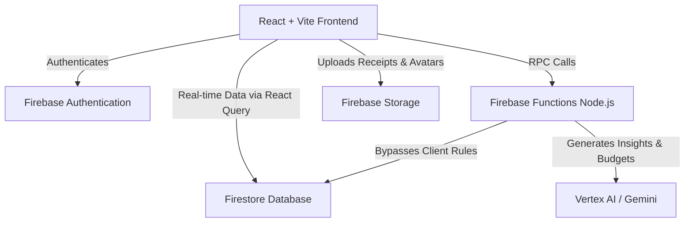

# Spendr 💸

**Spendr** is a production-ready, AI-powered personal finance application built for the modern Indian user. It simplifies expense tracking, group debt settlements, and financial planning through an intuitive mobile-first interface and deeply integrated AI assistants.

## 🌟 The Problem We Solve
Managing personal finances across multiple apps is exhausting. Splitting bills with roommates, tracking UPI payments, budgeting monthly expenses, and getting actionable financial advice typically requires four different tools. 

**Spendr unifies this experience.** It allows users to track expenses, settle debts within groups, and receive personalized AI insights in one seamless application.

## ✨ Key Features
- **Smart Expense Tracking**: Log daily expenses, incomes, and view beautiful analytical breakdowns.
- **Group Settlements**: Create groups, split bills (equally, by percentage, or custom amounts), and track who owes whom.
- **Debt Simplification**: Automatically calculates the most efficient way to settle group debts to minimize the number of transactions.
- **AI Financial Assistant (Aoede)**: A conversational AI that analyzes your spending patterns, warns you if you're approaching budget limits, and can even log expenses for you via voice or text.
- **Gamification & Rewards**: Earn XP and level up your financial wellness by maintaining streaks, staying under budget, and clearing debts.
- **UPI Integration**: Generate UPI payment links and QR codes to settle debts instantly.
- **Daily Hub & News**: Get a personalized feed of financial news and actionable AI-generated daily tips.

## 🏗 Architecture Overview

Spendr operates on a modern, serverless architecture entirely hosted on the Google/Firebase ecosystem, ensuring infinite scalability and zero maintenance overhead.



## 🛠 Tech Stack
- **Frontend**: React 18, Vite, TypeScript
- **Styling**: Tailwind CSS, Shadcn UI, Framer Motion
- **State & Data Fetching**: TanStack Query (React Query), Zustand
- **Backend Services**: Firebase Functions (Node.js)
- **Database**: Firebase Firestore (NoSQL)
- **Authentication**: Firebase Auth (Google Sign-In)
- **AI & ML**: Google Cloud Vertex AI (Gemini 2.5 Flash)
- **Hosting**: Firebase Hosting

## 🚀 Installation & Setup

### Prerequisites
- Node.js (v18+)
- `pnpm` (v9+)
- Firebase CLI (`npm install -g firebase-tools`)

### 1. Clone & Install
```bash
git clone https://github.com/banty1614-source/spendr.git
cd spendr
pnpm install
```

### 2. Configure Environment Variables
Copy the template and fill in your Firebase and Gemini credentials.
```bash
cp .env.example .env.local
```

### 3. Start Development Server
```bash
npm run dev
```

The application will be available at `http://localhost:5173`.

## 🔐 Environment Variables

| Variable Name | Purpose | Required |
| :--- | :--- | :--- |
| `VITE_FIREBASE_API_KEY` | Firebase Client API Key | Yes |
| `VITE_FIREBASE_AUTH_DOMAIN` | Firebase Auth Domain | Yes |
| `VITE_FIREBASE_PROJECT_ID` | Firebase Project ID | Yes |
| `VITE_FIREBASE_STORAGE_BUCKET` | Firebase Storage Bucket | Yes |
| `VITE_FIREBASE_MESSAGING_SENDER_ID` | Firebase Cloud Messaging ID | Yes |
| `VITE_FIREBASE_APP_ID` | Firebase Web App ID | Yes |
| `VITE_GEMINI_API_KEY` | Google AI Studio Key (for client-side fallback) | Yes |

## 📂 Project Structure
- `/frontend`: The complete React web application.
  - `/src/app`: UI Components and Screens.
  - `/src/lib/firebase`: Core Firebase configuration and data models.
  - `/src/services`: AI, Voice, and third-party integrations.
  - `/src/hooks`: TanStack Query data fetching logic.
- `/backend/functions`: Secure Node.js serverless backend for AI and gamification logic.
- `/infrastructure`: Security rules for Firestore and Storage.

## 🚀 Deployment Guide
Spendr is deployed natively via Firebase CLI. Ensure you are logged in to the correct Firebase project.

```bash
# Deploys Firestore Rules, Storage Rules, Functions, and the Frontend
npm run deploy:firebase
```

## ⚡ Performance Optimizations
- **Stale-While-Revalidate**: Extensive use of React Query to instantly load cached data while fetching fresh data in the background.
- **Bundle Splitting**: The massive Firebase SDK is chunked asynchronously (`auth`, `firestore`, `core`) to guarantee fast mobile load times.
- **Skeleton Loaders**: UI layout shifts are prevented using animated skeleton placeholders during network latency.

## 🛡 Security Measures
- **Backend-Authoritative Gamification**: Users cannot arbitrarily increase their XP or manipulate their subscription tiers; this logic is locked behind Firebase Functions.
- **Document-Level Security Rules**: Firestore rules ensure users can only read/write data for groups they are explicitly a member of.
- **Storage Quotas**: Firebase Storage rules prevent malicious uploads (capped at 2MB for avatars).

## 🗺 Roadmap
- **Current**: Expense tracking, AI insights, Group splitting, Gamification.
- **Upcoming**: Native iOS/Android apps via Capacitor, Bank Account Syncing (Account Aggregator framework).
- **Long-Term**: Automated mutual fund investments and personalized wealth management.

## 🤝 Contributing
We welcome contributions! Please see our [CONTRIBUTING.md](./CONTRIBUTING.md) for branch strategies, commit conventions, and pull request guidelines.

## 📄 License
This project is licensed under the MIT License - see the [LICENSE](./LICENSE) file for details.
