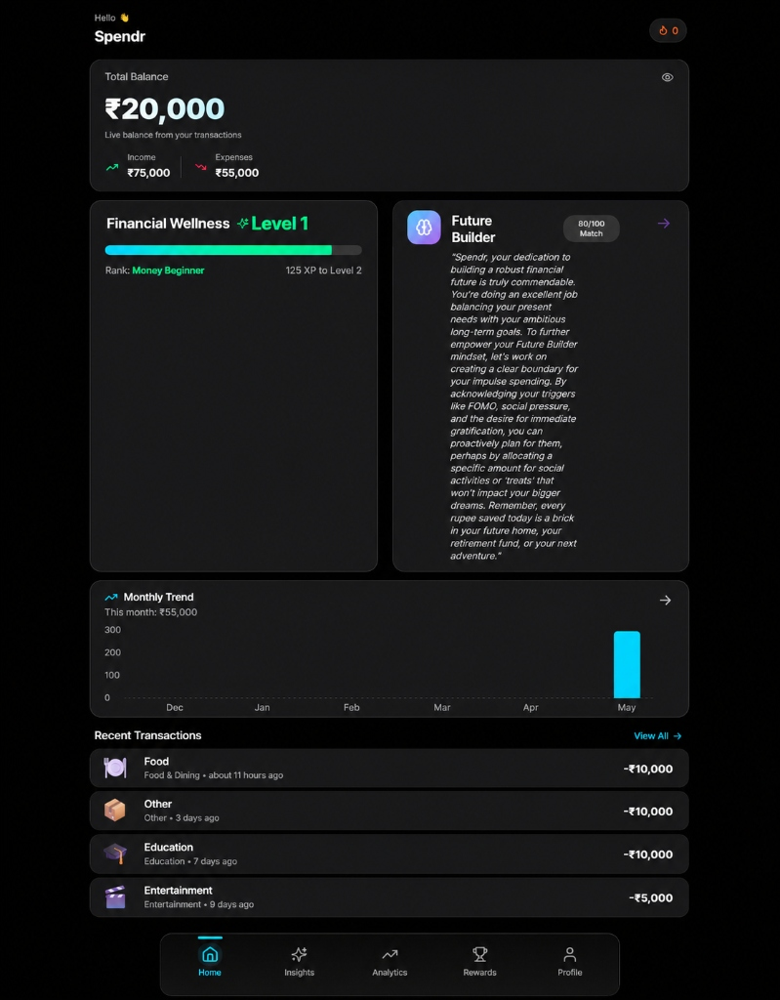
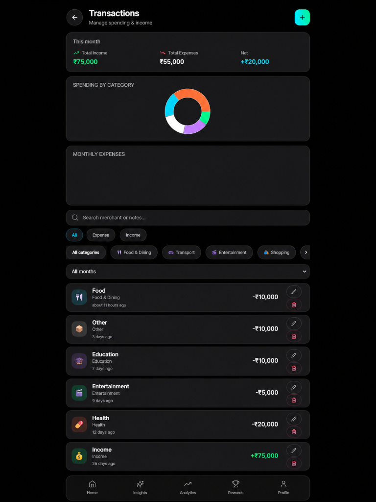
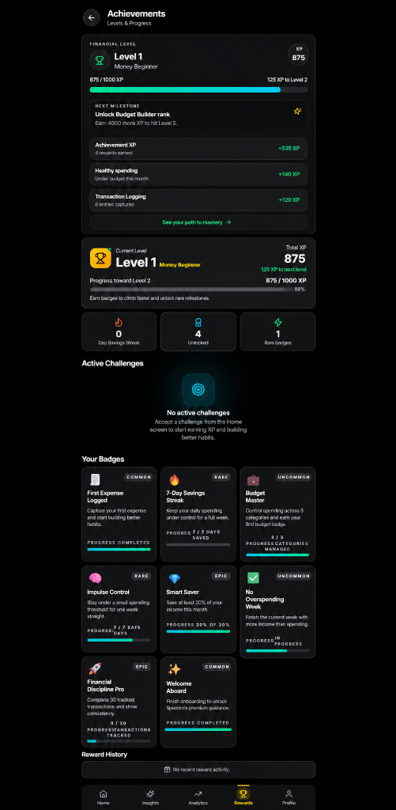
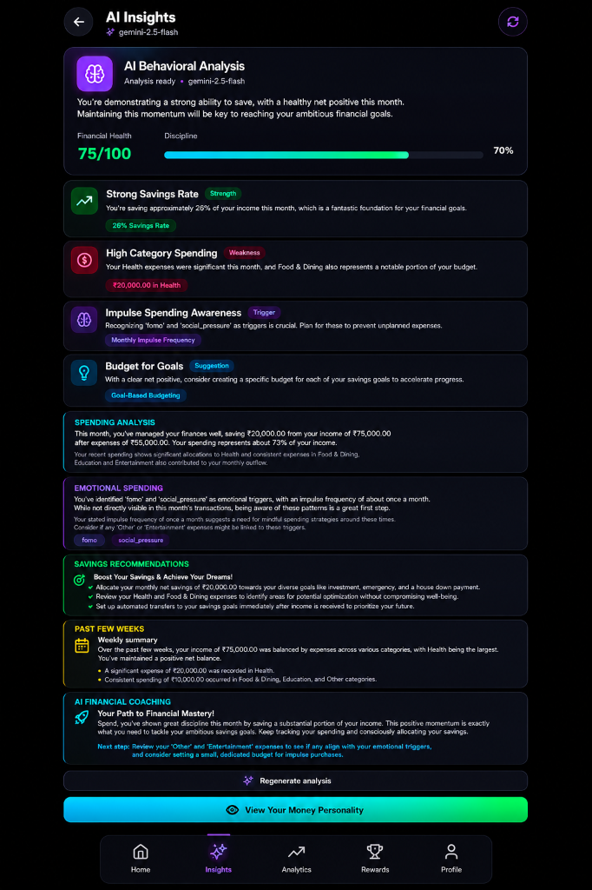
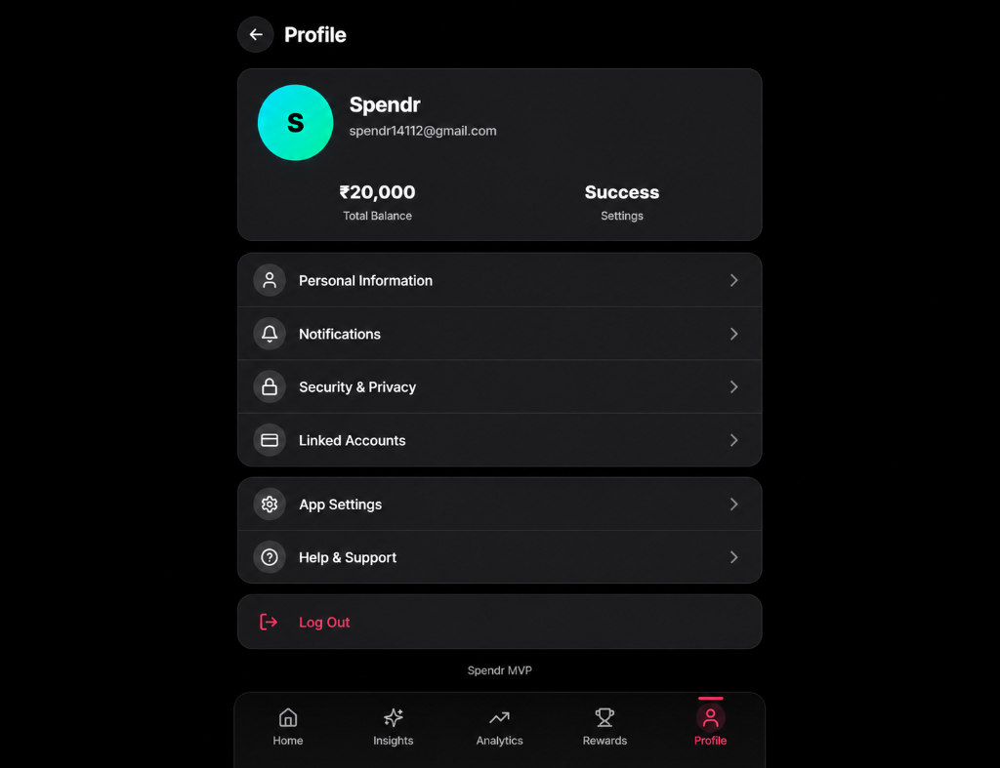

<h1 align="center">Spendr</h1>

<p align="center">
  <em>A personal finance and expense tracking application that helps you build better financial habits.</em>
</p>

<p align="center">
  
  
  
</p>

## Overview

Spendr was built out of a need for a modern, fast, and intelligent expense tracker. Unlike many bloated financial apps, Spendr aims to provide essential tracking with gamified habits, and meaningful AI insights that actually help you understand *why* you spend, not just *what* you spend.

This is an actively evolving project. It started as an MVP and is steadily gaining more robust features to support comprehensive personal finance management.

**Current Limitations & Tradeoffs:**
- **Manual Entry:** Currently relies on manual transaction entry rather than bank sync (by design for mindfulness, but also due to API costs).
- **Currency:** Primary focus is currently INR, though basic support for other currencies exists.
- **Offline Mode:** Initial offline support via PWA exists, but sync conflicts in multi-device offline usage might still occur.

---

## 📸 Screenshots

### Dashboard


### Transaction Management


### Gamification & Achievements


### AI Insights


### User Profile


---

## ✨ Features

### Current Features
- **Comprehensive Dashboard:** View your total balance, income vs. expenses, financial wellness level, AI-generated 'Future Builder' insights, monthly trend charts, and recent transactions at a glance.
- **Gamification & Achievements:** Stay motivated with a leveling system (e.g., "Level 1: Money Beginner"). Earn XP and unlock specific badges like *7-Day Savings Streak*, *Budget Master*, *Smart Saver*, and *Impulse Control*.
- **Transaction Management:** Quickly log income and expenses. View detailed doughnut charts for category spending and bar charts for monthly breakdowns. Easily filter, edit, or delete transactions.
- **AI Financial Insights:** Powered by Gemini 1.5 Flash. Get in-depth analysis on your savings rate, high category spending, and emotional triggers (like FOMO or social pressure). Receive personalized coaching, goal-based budget suggestions, and a breakdown of your past weeks' performance.
- **Profile & Settings:** Centrally manage personal information, security, notifications, and linked accounts.
- **Responsive UI:** Works seamlessly on desktop and mobile web with a premium dark-mode aesthetic.
- **Native Android Support:** Compiled into a standalone Android APK using Capacitor with native Share sheet integration.
- **PWA Support:** Installable as a progressive web app for quick access on any device.

### Planned Features
- Recurring transaction automation.
- Multi-currency deep support with live exchange rates.
- Advanced custom categories and sub-categories.
- Export to CSV/PDF.

### Experimental Features
- Receipt scanning via camera/upload.

---

## 🛠 Tech Stack

| Category | Technology |
|---|---|
| **Frontend** | React 18, TypeScript, Vite, React Router 7 |
| **Styling & UI** | Tailwind CSS, Radix UI, Framer Motion, Shadcn UI |
| **State Management** | Zustand, React Query |
| **Backend & DB** | Firebase (Firestore, Functions, Auth) |
| **AI Integration** | Google Generative AI (Gemini) |
| **Charts** | Recharts |
| **Mobile Integration** | Capacitor |
| **Hosting & Deployment**| Vercel (Frontend), Firebase Hosting (Alternative) |

---

## 📂 Folder Structure

```
spendr-main/
├── api/                  # Backend functions/API routes
├── docs/                 # Project documentation
├── public/               # Static assets
└── src/
    ├── app/              # Routing and page components
    ├── hooks/            # Custom React hooks
    ├── lib/              # Utility functions and library configs
    ├── locales/          # i18n translation files
    ├── services/         # Firebase and AI service wrappers
    ├── store/            # Zustand state stores
    ├── styles/           # Global CSS and Tailwind configs
    └── types/            # TypeScript type definitions
```

---

## 🚀 Installation Guide

### 1. Clone the repo
```bash
git clone https://github.com/banty1614-source/spendr.git
cd spendr
```

### 2. Install dependencies
```bash
npm install
# or
pnpm install
```

### 3. Setup environment variables
Copy the example environment file and fill in your Firebase and Gemini credentials.
```bash
cp .env.example .env.local
```

### 4. Run development server
```bash
npm run dev
```

### 5. Build for production (Web)
```bash
npm run build
```

### 6. Build Android APK (Capacitor)
```bash
# Build the frontend and sync Capacitor plugins
npm run build
npx cap sync android

# Compile the APK (Requires Android Studio / SDK)
cd android
./gradlew assembleDebug

# The APK will be available at: android/app/build/outputs/apk/debug/app-debug.apk
```

---

## ⚙️ Environment Variables

Refer to `.env.example` in the root directory for a full list of required variables. We strictly use `.env.local` for local development.

**Note:** Never commit `.env.local` to version control.

---

## 🌐 Deployment

Spendr's frontend is optimized for deployment on **Vercel** (`vercel.json` included), but it also supports **Firebase Hosting** (`firebase.json` included).

- **Frontend:** Deployed via Vercel for fast global CDN delivery.
- **Backend:** Firebase Firestore handles database operations and Firebase Auth handles user sessions.
- **Rules:** Firestore rules (`firestore.rules`) secure data per user.

---

## 🤖 AI Integration

Spendr integrates **Google's Gemini 1.5 Flash** model to provide personalized financial insights.
- **What it does:** Analyzes your transaction history to provide behavioral insights, identify impulse spending triggers, and suggest goal-based budgets.
- **Architecture:** The Gemini API is securely proxied through a **Vercel Serverless Function** (`api/generateInsight.ts`). 
- **Security:** Strict `systemInstruction` parameters are enforced server-side to prevent prompt injection and jailbreak attempts.
- **Cost & Rate Limits:** The endpoint implements basic IP/UID rate limiting to protect your API quota from abuse.
---

## ⚡ Performance & Optimization

- **Current Optimizations:** Vite build system, React Query for caching server state, Zustand for lightweight client state, and code splitting via React Router.
- **Areas for Improvement:** Large chart datasets may cause minor render delays on low-end mobile devices. Image compression is implemented but can be further optimized.

---

## 🔒 Security Notes

- **AI Proxy:** The Gemini API is secured behind a backend Vercel proxy, preventing clients from dictating arbitrary prompts (Server-Side Request Forgery mitigation).
- **Authentication:** Firebase Authentication manages secure sign-in and ID tokens, which are verified on the backend before any AI request is processed.
- **Database:** Firestore Security Rules ensure users can only read and write their own document paths (data isolation).
- **Content Security Policy (CSP):** The app enforces strict CSP headers, disabling `unsafe-eval` and restricting network/image sources to explicitly trusted domains to mitigate XSS data exfiltration.
- **Client-Side:** Environment variables prefixed with `VITE_` are exposed to the client. Do not place sensitive admin secrets (like the raw Gemini API key) in these client-facing variables.

---

## 🗺 Roadmap

- **Short-term:** Improve offline PWA capabilities and finalize the gamification badge system.
- **Mid-term:** Add recurring transactions and CSV export functionality.
- **Long-term:** Bank synchronization via secure aggregators (e.g., Plaid) and multi-currency support.

---

## 🔗 Links

- **GitHub Repository:** [https://github.com/banty1614-source/spendr.git](https://github.com/banty1614-source/spendr.git)
- **Vercel Deployment:** [https://spendr-main.vercel.app](https://spendr-main.vercel.app)
- **Firebase Hosting:** [https://spendr-app-85a7b.web.app](https://spendr-app-85a7b.web.app)
- **Documentation / Architecture:** [docs/ARCHITECTURE.md](docs/ARCHITECTURE.md)
- **Contributing Guidelines:** [CONTRIBUTING.md](CONTRIBUTING.md)

---

## 🤝 Contributing

We welcome contributions! Please see our [Contributing Guidelines](CONTRIBUTING.md) for details on how to submit pull requests, report issues, and suggest features.

---

## 📄 License

This project is licensed under the MIT License - see the [LICENSE](LICENSE) file for details.

---

## 💬 Developer Note

*Hey! Thanks for checking out Spendr. This is an actively evolving project built with a passion for helping people understand their money better. I'm building this in public and iterating based on real usage. If you spot a bug or have a feature idea, please open an issue. Let's build something genuinely useful together!*
